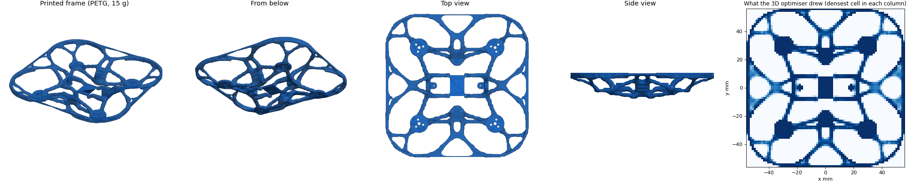

# PETGasus

A small 3D-printed quadcopter for an adult and a kid to build together. It needs no soldering, is designed to print in one piece, and flies by sight (no camera or goggles), mostly indoors.

**[See the design explained, with a 3D build-along →](https://neuman.github.io/PETGasusDrone/)**



| | |
|---|---|
| Frame | 112 × 112 × 20 mm, one piece, to print with tree supports (not printed yet): ~16 g in PETG, ~14 g in nylon-CF (PA6-CF) |
| Ready to fly | ~43 g, under the FAA's 250 g registration line |
| Props | 45 mm, each guarded round its outer side by a solid band about 4 mm tall |
| Flight time | ~3.7 min per 1S 320 mAh battery (estimate) |
| Electronics | Taken from a BetaFPV Meteor75 Pro II O4 kit: plug-in motors, no soldering |
| Control | ExpressLRS radio, Betaflight flight software, self-levelling mode |
| Cost | $167 for the full parts list, including radio, batteries and charger; $156 for the essentials (everything but the spare props and the strap). Both before shipping, at 7 October 2026 prices |

## Build one

- **[BUILD_GUIDE.md](BUILD_GUIDE.md)** covers the shopping list, the two measurements to take before printing, print settings, assembly, radio binding, Betaflight setup and first flights.
- **Print files:** [`build/print/frame.3mf`](build/print/frame.3mf) for Snapmaker Orca, Bambu Studio or PrusaSlicer, and [`build/print/frame.stl`](build/print/frame.stl) for anything else.

## Version 0.2: what changed, and why

Version 0.1 had a flat plate, tall ducts with lattice windows, and ribs and spokes
drawn from a 2.5D optimiser. Posted to r/diydrones, it was reviewed as "still a
2D design": flat planks butting into each other with no gussets, right angles
that printed PETG is weak at, ducts tall enough to make propwash, windows that
added weight, and a frame expected to break after a couple of crashes. The
review, paraphrased, is in [`inputs/references/`](inputs/references/diydrones-feedback-2026-10-17.md).

Version 0.2 answers it:

- **The frame is a 3D shape found by a topology optimiser**, not drawn by hand.
  It is told where the motors, props, board, battery and leads must be, what
  must stay empty, and thirteen ways the frame gets loaded (full thrust, two
  prop strikes, crashes on the guards from nine directions, and the battery).
  It decides where a 12 g budget of plastic carries those loads best. The model
  draws the result as one smooth solid with a fillet at every joint.
- **Low guards replace the ducts.** Each prop has a solid band about 4 mm tall
  round the side that meets walls. The optimiser decides what joins them: it
  closed the four into one rounded rim and tied each motor seat to it with
  V-shaped spokes.
- **It prints flat, as it flies, with tree supports.** A scan of print poses on
  CalculiX's crash stresses found that printing flat loses no strength to the
  layers: the worst crash tension runs along them. Poses tilted 75-105° would
  lose up to 14 %.
- **The filament was chosen by the numbers.** Seven filaments the Snapmaker U1
  can print went through the same CalculiX vibration and crash checks on the
  same shape (below).
- **Published numbers replace guesses.** The kit motor's own load table
  (66.6 g of thrust, not 46.3 g) and its height (13.6 mm) came from BetaFPV.
  The flight controller's shape (a cross about 40 mm tip to tip, with its motor
  sockets underneath) is measured from BetaFPV's photos. The build guide asks
  you to check it on the real board (A4).

### Which filament

| Filament | Frame | First vibration mode | Drop onto a guard | Wall hit |
|---|---|---|---|---|
| **PA6-CF** (the strong print) | 13.8 g | 196 Hz | 8.1 m | 3.7 m/s |
| PAHT-CF | 13.4 g | 193 Hz | 7.8 m | 3.4 m/s |
| **PETG** (the everyday print) | 16.2 g | 143 Hz | 2.0 m | 1.7 m/s |
| ASA | 13.3 g | 176 Hz | 2.0 m | 1.6 m/s |
| PETG with TPU 95A guard arcs | 16.1 g | 136 Hz | 1.9 m | 1.6 m/s |
| PETG-CF | 15.8 g | 146 Hz | 1.6 m | 1.6 m/s |
| PLA | 15.7 g | 169 Hz | 1.6 m | 1.5 m/s |
| *Limit* | | *200 Hz* | *1 m* | *3 m/s* |

PETG is the everyday filament: it needs nothing extra on the U1 and clears the
1 m drop. Only the two nylon-CF filaments clear both crash limits, so the crash
claims (C15, C16) are judged in PA6-CF. No filament reaches C4's 200 Hz. The
bar stays, in the flight-proven milestone with the hover, thrust and crash tests
on the real drone. The reasons for each rejection are in
[`decisions/petg-for-everyday-prints-pa6-cf-for-strong-ones.json`](decisions/petg-for-everyday-prints-pa6-cf-for-strong-ones.json).

The crash numbers are a floor, not a prediction: they ignore the plastic work
the filament does before it cracks, the floor's give and damping. They also
move by up to 20 % from one run to the next, because the tet mesher does not
give the same mesh twice. Fixing that is the next job.

## How the frame was designed

[`model/topopt3d.py`](model/topopt3d.py) writes the optimiser's problem from the
model: which cells must be frame (the motor seats, each guard's outer arc, the
board's posts, the strap's saddle), which must stay empty (the props and the air
above them, the motors, the board, the battery and its strap, each motor lead's
path, a screwdriver's way to each motor screw), what plastic under a prop costs
(its shadow on the downwash), and the load cases. The `solid-fea` pack in
[`.nopekit/packs/`](.nopekit/packs/solid-fea/) solves it, first on a 2 mm grid and
then refined on a 1.33 mm one. The field is an input in
[`inputs/data/`](inputs/data/), and [`model/geometry.py`](model/geometry.py) draws the
frame from it.

The optimiser is never asked whether its own design is good. CalculiX, a
different solver on a different mesh of the printed surface, judges that
([`gates/structure.py`](gates/structure.py)): the first vibration mode, with the
frame held at the board's posts and the strap's saddle, and the drop and wall hit
the free drone takes before the stress, averaged over 0.5 mm, reaches the
printed strength. Whether it survives a 10-year-old is the physical drop and
wall test (P1).

What was tried and rejected along the way (the optimiser's settings, the
drawing, the guards, the shadow limit, the filaments) is in
[`decisions/`](decisions/) and [`docs/decisions.md`](docs/decisions.md).

## What is proven and what isn't

Every number above comes from the model ([`model/petgasus.py`](model/petgasus.py)), the parts list ([`bom/bom.json`](bom/bom.json)) or the CalculiX runs ([`inputs/data/material-comparison.json`](inputs/data/material-comparison.json)). Each claim is a file in [`claims/`](claims/). The measurable claims (C1 to C17) each have an automated check, which counts only once it has been shown to fail on a known-bad design. The A claims are assumptions, and the P claims are tests on a real drone. Current state:

- **Pass (datasheets and geometry):** lift (5.7 times the weight), weight, flight time, no clashes between parts, the board's and the motors' screws, motor wire length, one piece, guard height, the shadow on the props (14.8 % of a disc, 15 % allowed), and a topology field solved for this design.
- **Fail:**
  - **The $150 budget (C10).** The full list is $167. The essentials are $156.
  - **A clean solid (C7).** Where the guard arcs meet on the left and right sides, the rim narrows to a strand 0.66 mm wide, under the 1.26 mm the printer needs.
  - **Prints on the U1 (C6).** The bridge check finds small ceilings with nothing under them (the largest 12 mm²), and 42 ledges longer than its 2 mm limit (the longest 9.9 mm). Tree supports should hold both up, but the check does not count supports, and nobody has sliced the frame yet to see.
- **Not yet counted (C4, C15, C16):** CalculiX's vibration and crash checks. A tier-2 check would count them, but the mesh check they rest on gives a different answer each run, because the tet mesher does not make the same mesh twice. Their numbers so far are in the filament table above.
- **Assumed, not yet measured (A1, A3, A4):** how much thrust the guards and the limbs under the props cost, and the shape of the kit's motor and board. The build guide's two measurements check the motor and the board before printing.
- **Not tested on a real drone yet (P1–P6):** crash drops and wall hits, hover, Betaflight setup, fit, thrust, and the supports coming off cleanly. Each test is described in its claim file and in the build guide.

The first print waits on C6 and C7, and on the build guide's two measurements (A3, A4).

## Working on the design

The checks run with [nopekit](https://github.com/neuman/nopekit). In Claude Code, this repo asks for the nopekit plugin: run `/plugin marketplace add neuman/nopekit`, then `/plugin install nopekit@nopekit`. To run the commands below in your own shell, install it with pip as well.

```sh
python3 -m venv .venv && . .venv/bin/activate   # Debian and Ubuntu refuse pip into the system Python
pip install -r requirements.txt
pip install git+https://github.com/neuman/nopekit
sudo apt install calculix-ccx         # the solver for the vibration and crash checks

python3 -m nopekit check --tier 1     # rebuild the model and run every check but CalculiX's
python3 -m nopekit check --tier 2     # CalculiX's checks too (about 45 minutes)
python3 -m nopekit site build         # regenerate the project site
python3 -m nopekit site serve         # plain-language front page at site/index.html
```

Change a number in `model/petgasus.py`, then run `check`. Once a change is final and every check passes on it, refresh the known-good reference with `python3 tools/freeze_known_good.py`, then run `check` again. Never freeze a design that fails a check.

A change that moves what the frame must hold or keep clear of makes the topology field stale (C17 fails). Solve it again with the pack's proposer, as its [`PACK.md`](.nopekit/packs/solid-fea/PACK.md) describes: first on the 2 mm grid (`topo_h` 2), then refined on the 1.33 mm one with `--warm` and `--c0-from` set to the 2 mm field. Then point `topology_field` at the new field. With the optional pypardiso installed, the two runs take about 45 minutes.

```sh
python3 -m nopekit propose fea.topopt3d --timeout 14400 -- \
    --problem build/topopt3d/problem.npz --variant <name>
```

| Path | What it is |
|---|---|
| `model/` | The single source of truth: parameters, geometry (manifold3d), the topology problem, assembly |
| `gates/` | The project's own checks (`structure.py` runs CalculiX); most read their limit from a claim |
| `claims/` | What must be true, with acceptance limits and reasons |
| `requirements/`, `milestones/`, `groups/` | What the drone is for, which claims each milestone needs, and how the site's map groups them |
| `decisions/` | What was chosen, what was rejected, and why |
| `inputs/` | Datasheets, references, and the optimiser's fields (`inputs/data/`) |
| `selftest/` | Known-good design and known-bad fixtures every check must catch |
| `bom/` | Parts, prices and sources |
| `.nopekit/packs/solid-fea/` | The topology optimiser and the CalculiX tooling |
| `views/`, `site/` | The project site (`site/index.html` is the plain-language front page). Pushing `site/` to `main` publishes it to GitHub Pages |
| `.nopekit/verdicts/` | Check results, kept as evidence |
